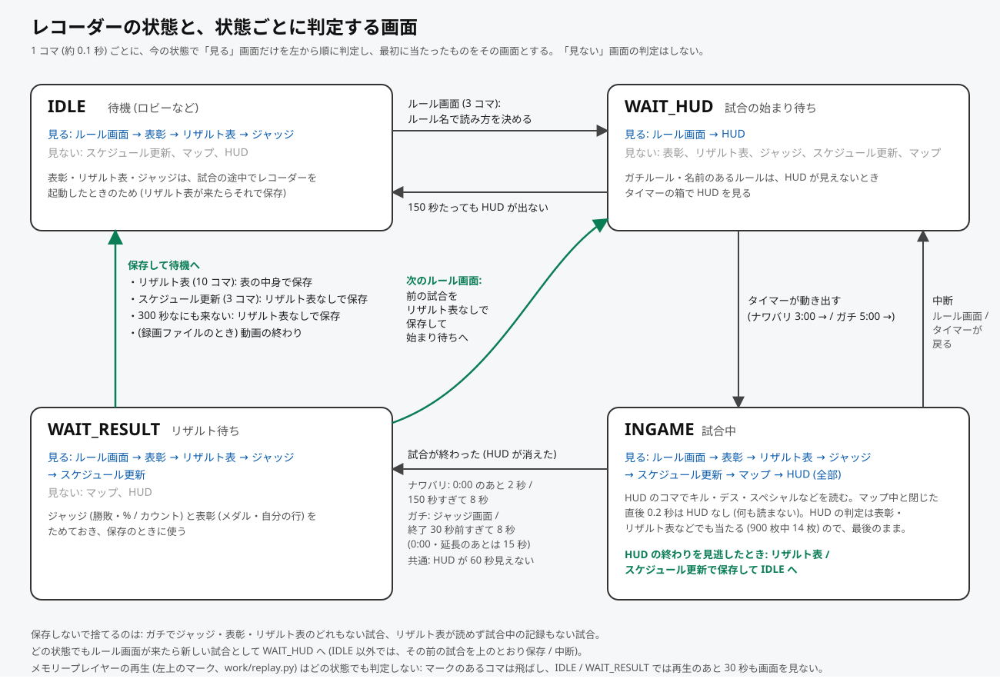

# レコーダー (状態機械とサンプリング)

`work/recorder.py` の `Recorder` が、録画でもライブでも同じ処理で試合を組み立てる。フレームループは `app/recorder.py` (`run_video` / `run_live`)。

## 考え方

- **画面の判定と状態を分ける**。毎コマまず「どの画面か」を判定し (`classify`)、画面が何コマか続いて安定した時点で一度だけ中身を解析する。状態 (IDLE / WAIT_HUD / INGAME / WAIT_RESULT) は「今なにを溜めているか」を表すだけ。表彰をすぐ飛ばす、リザルト表を見ずに次へ行くなど、操作で画面の間隔が変わっても追従できる。
- **状態ごとに意味のある画面だけを判定する** (`recorder.SCREENS`)。どの状態でも全部の判定をすると、それだけで 1 コマ数十 ms かかっていた ([処理時間](#処理時間))。

状態遷移図: [recorder_states.svg](recorder_states.svg)



## 状態と判定する画面

| 状態 | 意味 | 判定する画面 (この順、最初に当たったもの) | しない |
|---|---|---|---|
| IDLE | 待機 (ロビーなど) | ルール画面 → 表彰 → リザルト表 → ジャッジ | スケジュール更新、マップ、HUD |
| WAIT_HUD | ルール画面を見た。HUD の開始待ち | ルール画面 → HUD | 表彰、リザルト表、ジャッジ、スケジュール更新、マップ |
| INGAME | 試合中 | ルール画面 → 表彰 → リザルト表 → ジャッジ → スケジュール更新 → マップ → HUD (全部) | なし |
| WAIT_RESULT | HUD が消えた。試合後の画面待ち | ルール画面 → 表彰 → リザルト表 → ジャッジ → スケジュール更新 | マップ、HUD |

- IDLE で表彰・リザルト表・ジャッジを見るのは、試合の途中でレコーダーを起動したときにリザルト表で保存するため (ジャッジと表彰もそのとき使う)。
- INGAME で全部を見るのは: ジャッジはガチのノックアウトで試合の終わりを知るため。表彰・リザルト表・スケジュール更新は HUD の終わりを見逃したときに保存するため。マップは HUD を隠すため ([hud.md](hud.md#マップ))。
- HUD の判定を最後に置くのは、`hud.hud_visible` が保存済みの表彰・リザルト表・ルール画面 約 900 枚中 14 枚でも当たるため。HUD を先に見れば試合中の判定は安くなるが、順番は変えていない。
- ナワバリ以外のルールでは右上の塗りポイントが無く `hud_visible` が当たらないので、どの画面にも当たらなかったコマは WAIT_HUD / INGAME でタイマー欄を見て HUD かどうかを決める (`hud.timer_hud`、[hud.md](hud.md#hud-が見えているか))。

## 画面の判定

| 画面 | 関数 | 判定 | 安定とみなすコマ数 (`STABLE`) |
|---|---|---|---|
| ルール画面 | `scan_screens.looks_like_rule` | 「ルール」の黒いタグ (y 285〜335、x 830〜1090) の暗い画素 0.7〜0.95 かつ白文字 0.06〜0.25 (実測 0.84 / 0.13)。黒い説明タグ (x 700〜1210、y 685 か、イベントマッチでは y 755 から 45 px) の暗さ 0.45 以上。8 枚のカードの左下の `#nnnn` (コントラスト 100 以上) が 6 枚以上 (黄色いカードは文字が濃い茶色なので白文字を前提にしない)。ルール名は見ないので、どのルールでも通る | 3 |
| 表彰 (個人パネル) | `medals.looks_like_medals` | パネル (y 440〜700、x 900〜1720) の暗い画素 0.3 以上、見出し「ゲットした表彰」の白マスクがテンプレート (`work/templates/medals_header.png`) と相関 0.8 超 | 3 |
| リザルト表 | `live_result_watch.looks_like_result` | 8 行のブキ欄がどれも暗い (先に見るので試合中のコマはここで外れる)、表全体が暗い、上の帯が明るい | 10 (約 1 秒) |
| ジャッジくん画面 | `judge.read_label` | 左上の WIN! / LOSE... のテンプレート 0.7 以上 | 毎コマ投票 |
| スケジュール更新 | `schedule.looks_like_schedule_update` | 黒いしぶき (暗い画素 60% 以上) の上の白文字のテンプレート 0.7 以上 | 3 (表示は約 0.9 秒) |
| マップ | `hud.map_open` | 左上の × ([hud.md](hud.md#マップ)) | — |
| HUD | `hud.hud_visible` (ナワバリ) / `hud.timer_hud` (ほか) | タイマー欄と塗りポイント欄 / タイマー欄だけ | — |

暗い画素の割合 (`result_parser.dark_share`) は `cv2.inRange` で数える。numpy で `img.max(axis=2) < N` の平均を取ると、3 要素の軸の max が遅く、リザルト表と表彰の判定だけで 1 コマ 16 ms / 6 ms かかっていた (約 20 倍速くなり、値は同じ)。

## 試合の始まり

1. **ルール画面** (3 コマ続いたところ): 画面を保存し、ルール名の署名 (`rule_screen.title_signature`、kind `title`) を引いて解析の種類を決める (`RULE_ANALYSIS`、[ranked_rules.md](ranked_rules.md#解析の選び方))。カードを切り出して、やられた吹き出しとの照合用のテンプレートを作る。→ WAIT_HUD。
2. **カードの取り直し** (`RULE_CARDS_AT = 1.0` 秒): カードは上から 1 枚ずつフェードインする。ルール画面 11 回を 60 fps で測ると、出始めから 0.2 秒ではまだ無く (最終の見た目との相関 ~0)、0.5 秒で 0.90 以上、1 秒で 0.89〜0.99。3 コマ目 (約 0.2 秒) のカードを見本にすると吹き出しの照合点が 0.8 台 → 0.4 台に落ちて相手が決まらなかったので、出始めから 1.0 秒たった最初のルール画面のコマでカードと保存画像を取り直す (ログ「player cards taken 1.0s into the rule screen」)。
3. **WAIT_HUD**: タイマーが 3:00 のあいだ、8 人のイカ枠を 0.4 秒以上あけて最大 3 回切り出しておく (全員生存中のブキアイコン。あとでリザルト行と紐づける、[weapon_icons.md](weapon_icons.md#hud-スロットとリザルト行の紐づけ))。2:59 以下を読んだら `t0 = t − (180 − 残り秒)` として INGAME へ。
   - タイマーが 3:00 より大きい (3 コマ) か、ルール名がナワバリ以外なら、そのルールの長さ (ガチは 5:00、名前の無いルールは最初に読めた値を分単位に切り上げ) で同じことをする (`start_nonturf`)。ルール名がナワバリなのにタイマーが 5:00 ならログに出してタイマーに従う。
   - 150 秒たっても HUD が出なければ IDLE に戻る。

## 試合中 (INGAME)

HUD が見えるコマ (マップ中と閉じてから `MAP_AFTER = 0.2` 秒は見えない扱い) で読むもの ([hud.md](hud.md)):

- タイマー、8 人のイカ枠の状態、自分のスペシャルゲージ (色と量)、自分のキルフィード
- ナワバリ: 右上の塗りポイント (その秒にまだ読めていなければ)
- ナワバリ以外: 延長中!、ヤグラ / ホコの線か、エリア / アサリのカウント (1 秒に 1 回、読めるまで同じ秒の次のコマで読み直す。ルール名が無ければ見えている方を読む。`other` のルールは読まない)

HUD の有無にかかわらず毎コマ読むもの: やられた吹き出し (と相手カードの照合)、「やられた!」、「復活まであと」。

**タイマーの不整合**: ナワバリ以外で、読めたタイマーが試合の経過と 3 秒以上合わないコマは HUD なしにする (マップやスーパージャンプがタイマー欄にかかって「7:99」「0:99」などと読め、デスを多く数えていた)。

## 試合の終わり

| ルール | HUD が消えたとみなす条件 |
|---|---|
| ナワバリ | タイマー 0:00 を読んで HUD が 2 秒見えない、または開始から 150 秒すぎて 8 秒見えない |
| ナワバリ以外 | 終了 30 秒前をすぎて HUD が 8 秒見えない (0:00 か延長中!を見たあとは 15 秒、`END_GRACE`。延長中にやられるとマップが 10 秒ほど出る)。ジャッジくん画面が出たらその場で (ノックアウト) |
| 共通 | HUD が 60 秒見えない |

→ WAIT_RESULT。

## 保存のきっかけ

| きっかけ | 中身 |
|---|---|
| リザルト表 (10 コマ) | リザルト表で保存 (INGAME / WAIT_RESULT。IDLE でも直前の保存から 120 秒以上あいていれば、時系列なしの試合として保存) |
| スケジュール更新 (3 コマ) | INGAME / WAIT_RESULT ならその場でリザルト表なしで保存 |
| WAIT_RESULT のまま 300 秒 (`RESULT_WAIT`) | リザルト表なしで保存 |
| 次のルール画面 | WAIT_RESULT なら前の試合をリザルト表なしで保存して、新しい試合へ |
| 録画の終わり | `run_video` が途中の試合を保存 |

リザルト表なしで保存するときは、ジャッジくん画面 (勝敗・% またはカウント) と個人パネル (自分の行・ステージ・モード・ルール・表彰) を使う。ジャッジくん画面と表彰は「その試合のルール画面より後に出たもの」(ルール画面のない試合は保存の 400 秒以内) だけを付ける (`Recorder.belongs`)。リザルト表が飛ばされて次のルール画面で保存されると、表彰が保存の数分前になることがあるため。

**保存しないもの**: ナワバリ以外でジャッジくん画面・個人パネル・リザルト表のどれもない試合。リザルト表が読めず (下の妥当性チェックに落ちた)、試合中の記録もない試合。ライブのループを止めたときの途中の試合も保存しない。

## 保存の中身 (`finish`)

1. **リザルト表の解析** (`result_parser.parse`) と妥当性チェック (`result_sane`): 自分の行 (黄色い矢印) があり、ブキ欄の一致度 0.6 以上が 6 行以上、名前の付いたブキが 3 行以上、数字の塗りポイントが 6 行以上。ロビー画面をリザルト表と誤認したことがあるため。落ちたらリザルト表なしの扱い。ガチならカウントも読む ([ranked_rules.md](ranked_rules.md#カウントとチームのポイント))。
2. **ブキアイコンのサンプル集め** (ライブだけ、[weapon_icons.md](weapon_icons.md#サンプル集め))。
3. **8 人のデス** (イカ枠の暗さの連続区間、[hud.md](hud.md#8-人のデス-イカ枠))、**スロットとリザルト行の紐づけ**、**イベント** (death / kill / killed_by / special / special_ready)、**timeline** (毎秒)。
4. ジャッジくん画面の多数決 (`judge_summary`): ラベルはスコア 0.9 以上の票の多数決、% とカウント・ポイントは 2 コマ以上で一致した読みだけ。リザルト表があれば比べてログ (`judge check: same` / `MISMATCH`、食い違えばジャッジくん画面の画像も保存)、無ければ勝敗と % (カウント) をジャッジくん画面から入れる (`notes = 'no result screen: result and % from the judge screen'`)。
5. 個人パネル: リザルト表があれば比べてログ (`panel check`) とパネルのブキの学習、無ければ自分の行を入れる (`notes` に `own row and stage from the result panel`)。
6. ログの `self check` に、ゲージから数えたスペシャルとリザルト表の SP 回数、HUD の最後の塗りポイントとリザルト表、吹き出しの数とデス数を並べて出す。

試合ごとに、DB の行とは別に `samples/matches/{stamp}.json` (試合・選手・イベント・表彰・timeline・ジャッジ・パネルの読み) を残す。

### 証拠の画像

- **やられた吹き出し**: 吹き出しごとに、相手カードの照合の最高点と 2 位を記録し、最高点の切り出し (320x880) と同時刻の縮小フレームを並べて `samples/bubbles/{stamp}_{試合内秒}s_card{1位}_2nd{2位}.jpg` に保存する (`BUB_EVIDENCE_BELOW = 1.01` なので今は全部)。
- **吹き出しの無い自分のデス**: 「復活まであと」が出たのに前後 (−4〜+8 秒) に吹き出しが無かったら、直前 5 秒〜後 8 秒の縮小フレーム (480x270、0.5 秒おき) を連結して `samples/misses/` に保存する。
- **見逃したルール画面** (`work/rule_miss.py`、2026-11-13): IDLE のまま試合が始まったら (タイマー欄の数字が 2 回続けて開始の値 3:00 / 5:00 と読め、その前 30 秒は読めるタイマーが無く、レコーダーも 30 秒以上動いている)、ログに `RULE SCREEN MISSED?` の 1 行 (コマの大きさ、黒と白のレベル、1 秒あたりのサンプル数、720p より細かい絵があるか (`detail`、ネイティブ 1080p 0.74〜0.77 / 720p の拡大 0.58〜0.71)、直前 30 秒にルール画面の 3 つの判定のうち 1〜2 つだけ通ったコマの数と落ちた判定、いちばんルール画面に近かったコマの値) を出し、直前 30 秒の縮小フレーム (320x180、0.5 秒おき) の連結を `samples/misses/{stamp}_rule_missed.jpg`、そのときの HUD のコマと、いちばん近かったコマを原寸の PNG で `samples/matches/{stamp}_rule_missed_hud.png` / `_closest-13.2s.png` に保存する。診断だけで、試合は始めないし保存もしない。保存はレコーダー 1 回の実行で 3 回まで、前の保存から 600 秒以内はしない (ログの行は毎回出す)。普通にルール画面を見た試合では動かない (IDLE でしか見ない)。IDLE の 1 コマあたりの追加は約 0.3〜0.5 ms (ルール画面の 3 判定は 0.3 秒に 1 回。タイマーは黒い枠が出ているあいだ、2 回読めるまで: 最初の 5 秒は毎コマ、そのあとは 0.5 秒に 1 回。リザルト表にも同じ所に暗い枠がある)。
- ライブのループは最初のコマの大きさと、デバイスの申告する解像度・fps をログに出す (1920x1080 でなければそう書く)。

## サンプリングと位相

入力は 60 fps、解析するのは 6 コマに 1 コマ (約 10 fps)。出来事が 6 コマのどこに来るかで結果が変わりうるので、**読み取りを変えたら 6 つの位相すべてで確かめる**。

```
python work/phase_check.py VIDEO [VIDEO ...] [--out DIR]
```

1 回デコードしたコマを 6 つのレコーダー (位相 k はコマ k, k+6, k+12, ... を解析、DB・ライブラリには書かない) に配り、試合ごとの数 (キル・デス・やられた相手・スペシャルなど) と位相で変わるところを出す。テストにも位相をずらす確認がある (`test_the_cards_are_taken_once_they_have_faded_in_at_every_phase`、`test_the_map_hides_the_hud_at_every_phase`)。

### コマを増やしても良くならない (2026-10-30 の調査)

録画 6 本 9 試合を、10 fps (位相 6 通り) / 20 / 30 / 60 fps で、レコーダーを変えずに比べた。

- 数 (キル・自分のデス・スペシャル・やられた回数) は 10 / 20 / 30 fps でほぼ同じ。コマを増やして新しく取れたのは、試合終了 0.1 秒前のデスの吹き出し (60 fps で 1 コマだけ映る) の 1 件だけ。
- 時刻の細かさは、60 fps との差が 10 fps でキル・スペシャル・吹き出し ±0.08 秒、デスの始まりが平均 +0.04 秒 (最大 +0.3 秒前後)。30 fps で ±0.02 秒 (デスは最大 +0.15 秒)。
- 今の判定のまま 60 fps にすると**悪くなる**。「何コマ続いたか」で決めている判定が短い時間で通ってしまうため: キルフィードの確定 (0.4 秒に 3 回) が 0.05 秒で通ってリスポーン地点選びの「スタート地点」ボタンをキルと数える、スペシャル満タン (2 コマ) が増える、ルール画面 (3 コマ) を出始めのちらつきで 2 回取る、吹き出し中のカード照合 (1 コマ約 14 ms) が 16.7 ms に収まらない。コマが多いほど自分のデスも数えすぎた (リザルト表 8 に対し 10 fps で 8〜9、60 fps で 11)。

なのでコマ数は 10 fps のまま、位相で揺れる読み取りを直す方針にした。カードの取り直し ([試合の始まり](#試合の始まり)) とスペシャルの偽物の除外 ([hud.md](hud.md#スペシャル発動)) で、6 位相の録画 9 試合でスペシャルがリザルト表と 54 件中 54 件一致、やられた相手の決まる数が位相で揺れなくなった。まだ位相で揺れるものは [limitations.md](limitations.md)。

## 処理時間

1 コマあたり (録画で計測、ナワバリ / ガチホコ、2026-10-30):

| 状態 | 状態ごとの判定にする前 | 判定を絞ったあと | 試合中の処理を詰めたあと |
|---|---|---|---|
| IDLE | 32 / 29 ms | 4.3 / 3.9 ms | 2.3 / 3.0 ms |
| WAIT_HUD | 28 / 22 ms | 1.5 / 3.1 ms | 0.8 / 1.9 ms |
| INGAME | 40 / 40 ms | 13.1 / 16.6 ms | 4.8 / 6.4 ms |
| WAIT_RESULT | 42 / 38 ms | 16.0 / 16.6 ms | 11.5 / 12.1 ms |

試合中を優先して詰めた (配信や OBS と一緒に動かすときの負荷が減り、`finish()` のあとの追いつきも早く終わる)。どれも出す値は同じになる変更:

- 数字読み (`Glyphs.read`): テンプレートを前もって平均 0・長さ 1 にしておき (`Glyphs.zset`)、相関を行列 1 回で出す (1 文字ごとに `np.corrcoef` だとタイマー 1 回で約 3 ms)。
- `hud.read_timer` は同じコマなら前の結果を返す (ガチでは `timer_hud` と `sample()` が同じコマを読む)。
- 白・明るい・暗いマスクは `cv2.inRange` (`white_mask` / `bright_mask` / `dark_share`)。
- リザルト表の判定は小さいブキ欄を先に見る (試合中のコマは 1 ms → 0.04 ms)。
- 「やられた」「復活まで」の照合は白マスクが空なら飛ばす (TM_CCOEFF_NORMED は平らな画像に 0 を返すので値は同じ)。
- イカ枠 8 つの HSV 変換を帯全体で 1 回に (`hud.slot_states`)。
- 最後に HUD が見えた時刻を持ち回る (`m['last_vis']`、毎コマ全サンプルを走査していた)。
- 見逃し用の縮小フレームは 0.5 秒ごと (`RING_STEP`、毎コマ縮めると 1.6 ms)。
- ルール画面の判定 (2026-11-13): 「ルール」タグの白文字と、フェスの配置を見分ける `card_tops` を `cv2.inRange` / `cv2.min` で、8 枚の `#nnnn` のコントラストを `np.percentile` 1 回で出す。`looks_like_rule` + `card_tops` が 1 コマ 7.6 ms → 1.2 ms (保存済みの画面 1641 枚で判定は同じ)。
- ライブのループは解析するコマだけ `retrieve()` する。

吹き出し中は相手カードの照合で 1 コマ約 14 ms 増える ([hud.md](hud.md#やられた相手-吹き出しのカード))。
